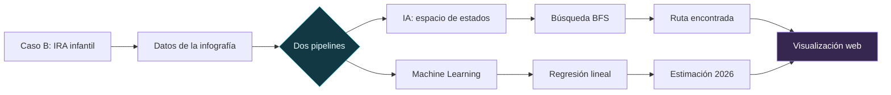
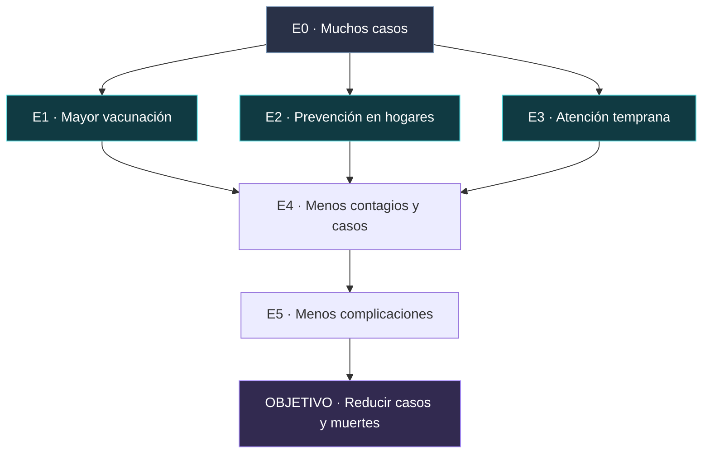

<!-- ================================================== -->
<!-- IRA INTELLIGENCE | README VISUAL | UPCH 2026-2 -->
<!-- Autor: QUISPE CHARRES MATHIAS DYLAN HENRY -->
<!-- ================================================== -->

<p align="center">
  
</p>

<p align="center">
  
</p>

<p align="center">
  
  
  
  
</p>

<p align="center">
  
  
  
  
  
  
</p>

<br>

<div align="center">

# IRA INTELLIGENCE


<br><br>

> **Análisis y predicción de episodios de infecciones respiratorias agudas en niños menores de cinco años en el Perú, mediante IA y Machine Learning.**

<br>

<a href="https://dylan200-7.github.io/Challenge_IRA_INTELLIGENCE/">
  
</a>
<a href="https://colab.research.google.com/drive/1J1M6N1k2tDGfgskAupz1Rbc5pt-r3fHn">
  
</a>
<a href="https://colab.research.google.com/drive/1RbeuBiPupfCMM-e1aTYJhkooohWaGBW6">
  
</a>

<br><br>

**Universidad Peruana Cayetano Heredia · Ingeniería Informática**  
**Curso:** Machine Learning  
**Docente:** Yannick Patrick Carrasco Merma  
**Estudiante:** **QUISPE CHARRES MATHIAS DYLAN HENRY**

</div>

---

## Descripción del proyecto

**IRA Intelligence** es un proyecto académico individual desarrollado a partir del **Caso B: Infecciones Respiratorias Agudas (IRA)**. Su información de partida procede de la **infografía proporcionada para el caso** [1], basada en una noticia del Ministerio de Salud (MINSA) publicada el **23 de junio de 2025** [2]. Integra dos enfoques: la **representación y búsqueda de soluciones mediante IA** y el **análisis predictivo con regresión lineal**.

El trabajo se desarrolla en **GitHub y Google Colab**, y cuenta con una [plataforma web interactiva](https://dylan200-7.github.io/Challenge_IRA_INTELLIGENCE/) para visualizar el problema, el espacio de estados, la búsqueda BFS y los resultados del modelo.

<div align="center">

| Presentación del caso | Espacio de estados | Pipeline BFS | Modelo predictivo |
|:---:|:---:|:---:|:---:|
| **5 pts** | **5 pts** | **5 pts** | **5 pts** |
| Definición y justificación | Estados y restricciones | Exploración y búsqueda | Regresión y gráfica |

</div>

---

<details open>
<summary><h2>01 · Problemática: IRA en menores de cinco años</h2></summary>

<br>

Las **infecciones respiratorias agudas (IRA)** representan un problema relevante de salud pública en el Perú. Este proyecto analiza los **episodios de IRA y las defunciones por neumonía en niños menores de cinco años** a partir de la infografía del Caso B [1], elaborada con información de la noticia oficial del Ministerio de Salud (MINSA) [2].

### Datos observados en la infografía

<div align="center">

| Año | Episodios de IRA | Defunciones por neumonía |
|:---:|---:|---:|
| **2023** | **1 003 178** | **113** |
| **2024** | **883 959** | **82** |
| **2025** | **824 978** | **51** |

</div>

**Comparación reportada en la infografía:** los episodios de IRA en 2025 disminuyen aproximadamente **7 %** frente a 2024 y **18 %** frente a 2023 [1], [2]. Las defunciones por neumonía también presentan una reducción en esos mismos periodos comparados.

> **Importante sobre el periodo de observación:** las cifras **no son totales de años completos**. La nota del MINSA compara los mismos periodos de 2023, 2024 y 2025, con información de 2025 hasta la **semana epidemiológica 24 (15 de junio de 2025)** [2]. No deben presentarse como conteos anuales cerrados.

### Actores y poblaciones involucradas

La infografía identifica al **Ministerio de Salud (MINSA)**, al **Centro Nacional de Epidemiología, Prevención y Control de Enfermedades (CDC Perú)** y a las **Direcciones y Gerencias Regionales de Salud**. Menciona como poblaciones de interés a los niños menores de cinco años, los adultos mayores y otros grupos vulnerables [1]. El modelo de este trabajo se limita a los **episodios de IRA en menores de cinco años**.

### Intervenciones y recursos descritos

Entre las medidas presentadas se encuentran la **vacunación contra neumococo e influenza**, el **lavado de manos**, el **uso de mascarilla ante síntomas**, la **ventilación de ambientes** y la **atención oportuna en centros de salud**. También se menciona la campaña preventiva **«Abrigamos vidas»** [1], [2].

Como recursos disponibles se reportan **2 226 142 dosis de vacuna contra neumococo** y **8,2 millones de dosis contra influenza**, de las cuales **2,2 millones son pediátricas** y **6 millones corresponden a adultos**. Se mencionan además medicamentos, insumos y reservas de contingencia [1], [2]. **Estas cifras de disponibilidad no equivalen a dosis aplicadas ni a cobertura efectiva.**

### Problema identificado y justificación de IA

Aunque los episodios y las defunciones reportadas muestran una tendencia descendente, siguen siendo relevantes para la salud pública. Este proyecto plantea dos actividades académicas complementarias:

- **Inteligencia Artificial y BFS:** representar acciones preventivas como un espacio conceptual de estados, operadores y restricciones, y buscar una ruta desde un estado inicial hasta un objetivo.
- **Machine Learning y regresión lineal:** usar los **tres conteos comparables de episodios de IRA** para analizar la tendencia y realizar una estimación ilustrativa correspondiente a un **periodo comparable de 2026**.

La infografía **no informa** la cobertura real de vacunación, la distribución regional de casos y defunciones, los costos de las intervenciones, el impacto individual de cada medida ni factores climáticos o socioeconómicos. Tampoco demuestra relaciones causales [1]. Por lo tanto, **BFS no decide qué política sanitaria es superior y la regresión no predice el efecto de vacunar ni permite establecer causalidad**.

### Predicción obtenida con el modelo

<div align="center">

| Periodo estimado | Episodios de IRA | Procedencia |
|:---|---:|:---|
| **2026 (periodo comparable)** | **≈ 725 838** | **Cálculo de regresión lineal, no dato de la infografía** |

</div>

> **Fuente y alcance:** [1] es la infografía entregada en clase y [2] es la publicación del MINSA que sustenta sus cifras; la noticia se publicó el **23 de junio de 2025**, aunque el pie de la infografía indique «MINSA (2024)». El valor estimado para 2026 se obtiene del notebook, **no es una cifra oficial ni el pronóstico de todo el año 2026**.

[Ver desarrollo completo del caso](./docs/presentacion-caso.md)

<br>
</details>

---

## ¿Cómo funciona IRA Intelligence?



---

<details>
<summary><h2>02 · Espacio de estados</h2></summary>

<br>

El problema se representa mediante un **modelo conceptual de siete estados**, incluyendo el estado inicial y el objetivo final.

<div align="center">

| Estado | Significado |
|:---:|---|
| **E0** | Muchos casos de IRA y neumonía (inicio) |
| **E1** | Mayor vacunación |
| **E2** | Prevención en hogares |
| **E3** | Atención temprana |
| **E4** | Menos contagios y casos |
| **E5** | Menos complicaciones |
| **OBJETIVO** | Reducir casos y muertes por IRA y neumonía infantil |

</div>

### Representación visual



**Operadores:** incrementar vacunación, promover prevención en hogares y facilitar la atención temprana.

**Restricciones:** disponibilidad de recursos, acceso a los establecimientos de salud y cobertura de las intervenciones.

El espacio de estados es una **simplificación académica del problema**, no un modelo clínico que garantice los resultados de las medidas propuestas.

[Ver documentación del espacio de estados](./docs/espacio-estados.md)

<br>
</details>

---

<details>
<summary><h2>03 · Pipeline de razonamiento, búsqueda y resultados</h2></summary>

<br>

Se utilizó **búsqueda en anchura (BFS)** sobre un grafo conceptual, implementada en Python con `deque`, para explorar rutas desde el estado inicial hasta el objetivo [4]. La representación se basa en las intervenciones descritas por la infografía [1], pero **las transiciones del grafo son una simplificación didáctica**, no efectos clínicos demostrados.

### Proceso de búsqueda


**Ruta encontrada:**

```text
E0 → E1 → E4 → E5 → OBJETIVO
```

La primera ruta encontrada pasa por **E1 (mayor vacunación)** debido al orden de exploración del grafo. Existen rutas de igual longitud pasando por **E2** o **E3**; el algoritmo no establece cuál intervención de salud es superior.

<div align="center">

<a href="https://colab.research.google.com/drive/1J1M6N1k2tDGfgskAupz1Rbc5pt-r3fHn"></a>
<a href="./notebooks/01_Razonamiento_Busqueda.ipynb"></a>

</div>

<br>
</details>

---

<details>
<summary><h2>04 · Pipeline de predicción y visualización</h2></summary>

<br>

Se eligió una **tarea de regresión** y el modelo **`LinearRegression` de scikit-learn** [5]. Permite analizar una tendencia lineal simple utilizando **tres observaciones de periodos comparables** (2023, 2024 y 2025) extraídas de la infografía [1] y sustentadas en la noticia del MINSA [2].

| Elemento | Descripción |
|---|---|
| **Entrada (`X`)** | Años de observación: 2023, 2024 y 2025 |
| **Salida (`y`)** | Episodios de IRA en el mismo periodo de cada año |
| **Modelo** | Regresión lineal |
| **Entrenamiento** | `modelo.fit(X, y)` |
| **Predicción** | `modelo.predict([[2026]])` (estimación académica para un periodo comparable) |
| **Visualización** | Datos observados, recta de ajuste y valor estimado |

### Entrenamiento y predicción

```python
from sklearn.linear_model import LinearRegression

modelo = LinearRegression()
modelo.fit(X, y)                   # Entrenamiento
prediccion = modelo.predict([[2026]])[0]
```

<div align="center">

### Resultado estimado para 2026 (periodo comparable)


</div>

Este valor es una **estimación académica**, no aparece en la infografía ni corresponde a un registro real de 2026. Dado que los tres datos se refieren a periodos comparables de cada año hasta aproximadamente la semana epidemiológica 24, **la cifra no debe presentarse como el total anual de 2026**. El modelo dispone de **solo tres observaciones**, no incluye variables explicativas sanitarias, no cuenta con validación fuera de muestra y **no representa un pronóstico epidemiológico validado**.

<div align="center">

<a href="https://colab.research.google.com/drive/1RbeuBiPupfCMM-e1aTYJhkooohWaGBW6"></a>
<a href="./notebooks/02_Modelo_Predictivo.ipynb"></a>
<a href="./datos/ira_dataset.csv"></a>

</div>

<br>
</details>

---

<details>
<summary><h2>05 · Mejoras y optimización de los pipelines</h2></summary>

<br>

Los notebooks publicados en `notebooks/` son versiones mejoradas de los ejercicios iniciales. Los cambios se enfocaron en la **organización del pipeline, la claridad de los resultados y la eliminación de una operación innecesaria**, sin cambiar el problema resuelto ni los resultados obtenidos.

### Bloque 1 · Razonamiento y búsqueda BFS

**Versión inicial:** la función `buscar_ruta()` retornaba únicamente la ruta encontrada, mientras la descripción de los estados y la ejecución estaban distribuidas en varias celdas.

**Versión mejorada:**

- Se organizó el desarrollo en tres etapas: razonamiento, búsqueda y resultados.
- Se unificó el nombre del estado final como `OBJETIVO`.
- La función retorna tanto la **ruta** como la lista de **estados visitados**.
- Se agregó una salida para mostrar la exploración BFS y una comprobación para el caso en que no se encuentre una ruta.
- Se mejoraron los nombres descriptivos, los comentarios y la explicación de la ruta.

**Resultado conservado:** `E0 → E1 → E4 → E5 → OBJETIVO`.

> **Alcance de la mejora:** el algoritmo continúa usando una lista `visitados` y una cola `deque`. No se implementó un conjunto para impedir que se encolen estados repetidos; la mejora documentada aquí es de organización, trazabilidad y manejo de la salida.

### Bloque 2 · Modelo predictivo y visualización

**Versión inicial:** el modelo de regresión lineal entrenaba con los datos de 2023–2025, calculaba la estimación de 2026 y generaba un gráfico. Además, calculaba `predicciones = modelo.predict(X)` sin utilizar posteriormente esa variable.

**Versión mejorada:**

- Se estructuró el procedimiento en datos, entrenamiento, predicción y gráfica.
- Se eliminó la variable de predicciones intermedias que no se utilizaba.
- Se añadieron mensajes de salida para identificar los datos y la finalización del entrenamiento.
- Se mejoró la gráfica con marcas para 2023–2026, etiquetas legibles y un marcador diferenciado para la estimación de 2026.
- Se agregó documentación sobre el significado y los límites de la predicción.

**Resultado conservado:** aproximadamente **725 838 episodios de IRA para un periodo comparable de 2026**.

### Comparación de versiones

| Aspecto | Versión inicial | Versión mejorada |
|---|---|---|
| Organización del BFS | Secuencia básica de celdas | Etapas de razonamiento, búsqueda y resultados |
| Salida de BFS | Devuelve la ruta | Devuelve ruta y estados visitados |
| Exploración BFS | No se mostraba por separado | Se muestra el orden de estados visitados |
| Manejo de ausencia de ruta | No había una salida explicativa específica | Muestra un mensaje cuando no se encuentra una ruta |
| Cálculos del modelo | Predicción intermedia sin uso | Se elimina esa operación |
| Gráfico | Presentación básica de datos y recta | Etiquetas, marcas anuales y predicción diferenciada |
| Resultado numérico | ≈ 725 838 para 2026 (periodo comparable) | ≈ 725 838 para 2026 (periodo comparable) |

**Conclusión:** las mejoras hacen más claro y fácil de revisar el desarrollo, y eliminan un cálculo redundante en el modelo predictivo. **No se afirma que el código sea más rápido**, ya que no se realizaron mediciones de rendimiento comparativas.

<br>
</details>

---

## Tecnologías involucradas

<div align="center">

### Análisis y Machine Learning


### Plataforma interactiva


</div>

---

## IRA Intelligence en una mirada

<div align="center">

```text
                    IRA INTELLIGENCE
                           │
                           ▼
                 CASO B: IRA INFANTIL
                           │
                  DATOS 2023 - 2025
                           │
               ┌───────────┴────────────┐
               ▼                        ▼
          INTELIGENCIA              MACHINE
           ARTIFICIAL               LEARNING
               │                        │
               ▼                        ▼
        ESPACIO DE ESTADOS       REGRESIÓN LINEAL
               │                        │
               ▼                        ▼
          BÚSQUEDA BFS             ENTRENAMIENTO
               │                        │
               ▼                        ▼
         RUTA ENCONTRADA         ESTIMACIÓN 2026
               │                        │
               └───────────┬────────────┘
                           ▼
                   VISUALIZACIÓN
                     INTERACTIVA
```

</div>

---

<details>
<summary><h2>Estructura del repositorio y documentación</h2></summary>

<br>

```text
Challenge_IRA_INTELLIGENCE/
├── index.html
├── assets/
│   ├── favicon.svg
│   └── ira-intelligence-banner.svg   # Encabezado visual del README
├── css/
├── js/
├── datos/
│   └── ira_dataset.csv
├── notebooks/
│   ├── 01_Razonamiento_Busqueda.ipynb
│   └── 02_Modelo_Predictivo.ipynb
├── docs/
│   ├── presentacion-caso.md
│   ├── espacio-estados.md
│   ├── documentacion.md
│   └── verificacion.md
└── README.md
```

**Documentación complementaria:**

- [Presentación del caso y problema](./docs/presentacion-caso.md)
- [Espacio de estados](./docs/espacio-estados.md)
- [Documentación de los pipelines](./docs/documentacion.md)
- [Verificación del proyecto](./docs/verificacion.md)

> La plataforma web representa de forma interactiva los pipelines con JavaScript. La ejecución de los algoritmos Python se realiza por separado en los notebooks de Google Colab.

<br>
</details>

---

## Autor del proyecto

<div align="center">


| Información | Detalle |
|:---|:---|
| **Nombre completo** | **QUISPE CHARRES MATHIAS DYLAN HENRY** |
| **Universidad** | Universidad Peruana Cayetano Heredia (UPCH) |
| **Carrera** | Ingeniería Informática |
| **Curso** | Machine Learning |
| **Tipo de entrega** | Challenge individual |
| **Caso** | B — Infecciones Respiratorias Agudas |

</div>

---

## Referencias

Las referencias se presentan en **formato IEEE**:

[1] “Infecciones Respiratorias Agudas (IRA) y Neumonía en Menores de 5 Años en el Perú: Principales datos de la noticia y variables para su análisis con IA,” infografía proporcionada como material del Caso B, curso Machine Learning, Universidad Peruana Cayetano Heredia, 2026. [Material de clase, autor de la infografía no identificado].

[2] Ministerio de Salud del Perú, “Episodios de infecciones respiratorias agudas y muertes por neumonía en menores de 5 años disminuyen,” *Plataforma Digital Única del Estado Peruano*, 23 jun. 2025. [En línea]. Disponible: https://www.gob.pe/institucion/minsa/noticias/1192975-episodios-de-infecciones-respiratorias-agudas-y-muertes-por-neumonia-en-menores-de-5-anos-disminuyen

[3] Centro Nacional de Epidemiología, Prevención y Control de Enfermedades, “Vigilancia de EDA/IRA/SGB (UTVEIS)”. [En línea]. Disponible: https://www.dge.gob.pe/portalnuevo/vigilancia-epidemiologica/vigilancia-de-eda-ira-sgb-utveis/

[4] Python Software Foundation, “collections — Container datatypes”. [En línea]. Disponible: https://docs.python.org/3/library/collections.html#collections.deque

[5] Scikit-learn Developers, “LinearRegression”. [En línea]. Disponible: https://scikit-learn.org/stable/modules/generated/sklearn.linear_model.LinearRegression.html

**Nota de procedencia:** las cifras y medidas preventivas se presentan en [1] y pueden contrastarse con la noticia original [2], cuyo corte corresponde al **15 de junio de 2025 (SE 24)**. El pie de la infografía señala «MINSA (2024)», pero la **fecha de publicación verificable de la fuente enlazada es 2025**. [3] complementa el contexto de vigilancia epidemiológica; [4] y [5] documentan las herramientas de programación. La estimación de 2026 procede del modelo, no de MINSA.

---

## Resumen final

IRA Intelligence integra **la búsqueda BFS** para representar posibles rutas dentro de un espacio de estados y **la regresión lineal** para estudiar una tendencia en los episodios de IRA registrados hasta un periodo comparable de cada año. La infografía y la noticia del MINSA permiten identificar los datos observados, las intervenciones reportadas y las variables que faltan para establecer relaciones causales. Los resultados pueden revisarse en **Google Colab** y explorarse visualmente desde **GitHub Pages**.

<p align="center">
  <a href="https://dylan200-7.github.io/Challenge_IRA_INTELLIGENCE/">
    
  </a>
</p>

<p align="center">
  <sub>© 2026 · IRA INTELLIGENCE · QUISPE CHARRES MATHIAS DYLAN HENRY · UPCH</sub>
</p>
