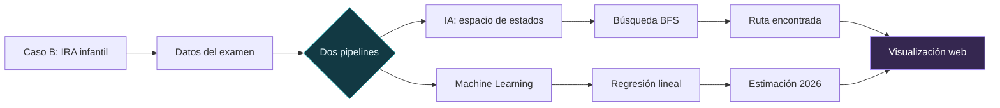
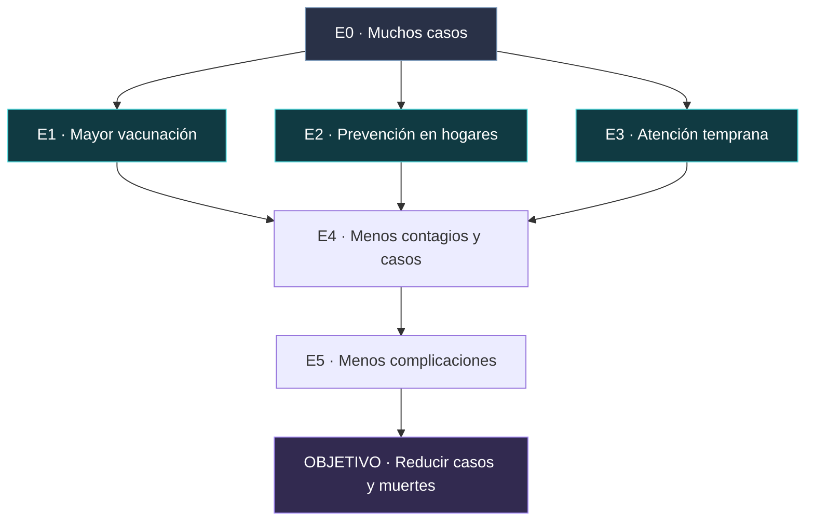
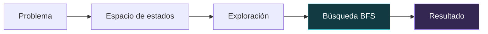

<!-- ================================================== -->
<!-- IRA INTELLIGENCE | README VISUAL | UPCH 2026-2 -->
<!-- Autor: QUISPE CHARRES MATHIAS DYLAN HENRY -->
<!-- ================================================== -->

<p align="center">
  
</p>

<p align="center">
  
</p>

<p align="center">
  
  
  
  
</p>

<p align="center">
  
  
  
  
  
  
</p>

<br>

<div align="center">

# IRA INTELLIGENCE


<br><br>

> **Análisis y predicción de episodios de infecciones respiratorias agudas en niños menores de cinco años en el Perú, mediante IA y Machine Learning.**

<br>

<a href="https://dylan200-7.github.io/Challenge_IRA_INTELLIGENCE/">
  
</a>
<a href="https://colab.research.google.com/drive/1J1M6N1k2tDGfgskAupz1Rbc5pt-r3fHn">
  
</a>
<a href="https://colab.research.google.com/drive/1RbeuBiPupfCMM-e1aTYJhkooohWaGBW6">
  
</a>

<br><br>

**Universidad Peruana Cayetano Heredia · Ingeniería Informática**  
**Curso:** Machine Learning  
**Docente:** Yannick Patrick Carrasco Merma  
**Estudiante:** **QUISPE CHARRES MATHIAS DYLAN HENRY**

</div>

---

## Descripción del proyecto

**IRA Intelligence** es un proyecto académico individual desarrollado a partir del **Caso B: Infecciones Respiratorias Agudas (IRA)** del examen parcial. Integra dos enfoques: la **representación y búsqueda de soluciones mediante IA** y el **análisis predictivo con regresión lineal**.

El trabajo se desarrolla en **GitHub y Google Colab**, y cuenta con una [plataforma web interactiva](https://dylan200-7.github.io/Challenge_IRA_INTELLIGENCE/) para visualizar el problema, el espacio de estados, la búsqueda BFS y los resultados del modelo.

<div align="center">

| Presentación del caso | Espacio de estados | Pipeline BFS | Modelo predictivo |
|:---:|:---:|:---:|:---:|
| **5 pts** | **5 pts** | **5 pts** | **5 pts** |
| Definición y justificación | Estados y restricciones | Exploración y búsqueda | Regresión y gráfica |

</div>

---

<details open>
<summary><h2>01 · Problemática: IRA en menores de cinco años</h2></summary>

<br>

Las **infecciones respiratorias agudas** representan un problema relevante de salud pública en el Perú. Este proyecto se centra en los episodios de IRA y la neumonía infantil en niños menores de cinco años, a partir de las cifras compartidas en el **material del examen parcial**. Como marco de contexto, el CDC Perú mantiene información sobre vigilancia epidemiológica de IRA [1].

### Datos del caso

<div align="center">

| Año | Episodios de IRA | Tipo de dato |
|:---:|---:|:---:|
| **2023** | **1 003 178** | Dato del examen |
| **2024** | **883 959** | Dato del examen |
| **2025** | **824 978** | Dato del examen |
| **2026** | **≈ 725 838** | **Estimación del modelo** |

</div>

El material del caso también indica **113 muertes por neumonía en 2023** y **51 en 2025**. Estas cifras se utilizan únicamente como contexto y **no forman parte del entrenamiento de la regresión**.

**Problema identificado.** Aunque los episodios disminuyen en los tres años analizados, la cantidad de casos continúa siendo considerable. Resulta útil organizar los datos, estudiar su tendencia y representar conceptualmente posibles intervenciones.

**¿Por qué utilizar IA y Machine Learning?** La IA permite representar el problema mediante estados y explorar rutas; Machine Learning permite ajustar un modelo de regresión a los datos disponibles para generar una estimación numérica. Ninguno de estos ejercicios demuestra causalidad entre una intervención y la reducción de casos.

> **Nota sobre los datos:** las cifras anteriores corresponden al material del examen parcial. No han sido contrastadas de forma independiente con una serie oficial comparable.

[Ver desarrollo completo del caso](./docs/presentacion-caso.md)

<br>
</details>

---

## ¿Cómo funciona IRA Intelligence?



---

<details>
<summary><h2>02 · Espacio de estados</h2></summary>

<br>

El problema se representa mediante un **modelo conceptual de siete estados**, incluyendo el estado inicial y el objetivo final.

<div align="center">

| Estado | Significado |
|:---:|---|
| **E0** | Muchos casos de IRA y neumonía (inicio) |
| **E1** | Mayor vacunación |
| **E2** | Prevención en hogares |
| **E3** | Atención temprana |
| **E4** | Menos contagios y casos |
| **E5** | Menos complicaciones |
| **OBJETIVO** | Reducir casos y muertes por IRA y neumonía infantil |

</div>

### Representación visual



**Operadores:** incrementar vacunación, promover prevención en hogares y facilitar la atención temprana.

**Restricciones:** disponibilidad de recursos, acceso a los establecimientos de salud y cobertura de las intervenciones.

El espacio de estados es una **simplificación académica del problema**, no un modelo clínico que garantice los resultados de las medidas propuestas.

[Ver documentación del espacio de estados](./docs/espacio-estados.md)

<br>
</details>

---

<details>
<summary><h2>03 · Pipeline de razonamiento, búsqueda y resultados</h2></summary>

<br>

Se utilizó **búsqueda en anchura (BFS)** sobre un grafo, implementada en Python con `deque`, para explorar rutas desde el estado inicial hasta el objetivo [2].

### Proceso de búsqueda



**Ruta encontrada:**

```text
E0 → E1 → E4 → E5 → OBJETIVO
```

La primera ruta encontrada pasa por **E1 (mayor vacunación)** debido al orden de exploración del grafo. Existen rutas de igual longitud pasando por **E2** o **E3**; el algoritmo no establece cuál intervención de salud es superior.

<div align="center">

<a href="https://colab.research.google.com/drive/1J1M6N1k2tDGfgskAupz1Rbc5pt-r3fHn"></a>
<a href="./notebooks/01_Razonamiento_Busqueda.ipynb"></a>

</div>

<br>
</details>

---

<details>
<summary><h2>04 · Pipeline de predicción y visualización</h2></summary>

<br>

Se eligió una **tarea de regresión** y el modelo **`LinearRegression` de scikit-learn** [3]. Su uso permite analizar una tendencia lineal simple y realizar una estimación a partir de los tres datos del caso.

| Elemento | Descripción |
|---|---|
| **Entrada (`X`)** | Años: 2023, 2024 y 2025 |
| **Salida (`y`)** | Episodios de IRA de cada año |
| **Modelo** | Regresión lineal |
| **Entrenamiento** | `modelo.fit(X, y)` |
| **Predicción** | `modelo.predict([[2026]])` |
| **Visualización** | Datos observados, recta de ajuste y valor estimado |

### Entrenamiento y predicción

```python
from sklearn.linear_model import LinearRegression

modelo = LinearRegression()
modelo.fit(X, y)                   # Entrenamiento
prediccion = modelo.predict([[2026]])[0]
```

<div align="center">

### Resultado estimado para 2026


</div>

Este valor es una **estimación académica**, no un registro real de 2026. El modelo se entrenó con **solo tres observaciones anuales**, sin separación de prueba ni validación epidemiológica; por ello, la cifra no debe interpretarse como un pronóstico clínico validado.

<div align="center">

<a href="https://colab.research.google.com/drive/1RbeuBiPupfCMM-e1aTYJhkooohWaGBW6"></a>
<a href="./notebooks/02_Modelo_Predictivo.ipynb"></a>
<a href="./datos/ira_dataset.csv"></a>

</div>

<br>
</details>

-- 

## 05 · Mejoras y optimización de los pipelines

Como parte del desarrollo del Challenge 1, se realizaron mejoras en los códigos iniciales de los Bloques 1 y 2. El objetivo fue organizar mejor los procedimientos, facilitar la comprensión de los algoritmos y presentar los resultados de manera más clara.

Las versiones mejoradas se encuentran en la carpeta `notebooks/` del repositorio.

### Bloque 1: Optimización del razonamiento y búsqueda BFS

En la primera versión se implementó el algoritmo BFS utilizando una cola `deque` para encontrar una ruta desde el estado inicial hasta el objetivo.

**Mejoras realizadas:**

- Se reorganizó el código en etapas de razonamiento, búsqueda y resultados.
- Se estandarizó el nombre del estado final como `OBJETIVO`.
- Se modificó la función `buscar_ruta()` para devolver tanto la ruta encontrada como los estados visitados.
- Se incorporó la visualización del orden de exploración del algoritmo BFS.
- Se agregó una validación para mostrar un mensaje cuando no existe una ruta.
- Se mejoraron los comentarios y la explicación de los estados, operadores y restricciones.

**Resultado:** Se conserva la ruta `E0 → E1 → E4 → E5 → OBJETIVO`, pero ahora se puede observar el proceso de exploración y comprender mejor cómo el algoritmo obtiene la solución.

### Bloque 2: Optimización del modelo predictivo

En la primera versión se implementó un modelo de regresión lineal utilizando `scikit-learn` para estimar los episodios de IRA en 2026.

**Mejoras realizadas:**

- Se eliminaron predicciones intermedias que se calculaban pero no se utilizaban.
- Se organizó el código en etapas de datos, entrenamiento, predicción y visualización.
- Se mejoró la representación gráfica diferenciando los datos históricos, la línea de regresión y la predicción para 2026.
- Se incorporaron etiquetas y marcas para identificar claramente los años analizados.
- Se agregaron explicaciones sobre la selección del modelo, el entrenamiento y sus limitaciones.

**Resultado:** Se mantiene la estimación de aproximadamente **725 838 episodios de IRA para 2026**, con una visualización más clara y un código mejor documentado.

### Comparación entre las versiones

| Aspecto | Primera versión | Versión mejorada |
|---|---|---|
| Organización | Código dividido en celdas básicas | Pipeline organizado por etapas |
| BFS | Devuelve la ruta encontrada | Devuelve la ruta y los estados visitados |
| Exploración | Sin salida específica del orden de exploración | Muestra la exploración BFS |
| Manejo de resultados | Presentación básica | Validación y explicación de resultados |
| Regresión lineal | Incluye un cálculo intermedio sin utilizar | Elimina ese cálculo innecesario |
| Visualización | Gráfico básico | Gráfico con etiquetas y marcadores mejorados |
| Documentación | Comentarios breves | Explicaciones técnicas e interpretación |

### Conclusión de las mejoras

Las modificaciones representan principalmente una optimización de la estructura, la trazabilidad y la presentación de los resultados. También se eliminó un cálculo innecesario en el modelo predictivo.

Se mantuvieron los algoritmos principales y los resultados originales, facilitando la comprensión, revisión y reproducción del trabajo.

Estas mejoras no representan una demostración de mayor velocidad de ejecución, sino una implementación más organizada y documentada de los pipelines de Inteligencia Artificial y Machine Learning.


---

## Tecnologías involucradas

<div align="center">

### Análisis y Machine Learning


### Plataforma interactiva


</div>

---

## IRA Intelligence en una mirada

<div align="center">

```text
                    IRA INTELLIGENCE
                           │
                           ▼
                 CASO B: IRA INFANTIL
                           │
                  DATOS 2023 - 2025
                           │
               ┌───────────┴────────────┐
               ▼                        ▼
          INTELIGENCIA              MACHINE
           ARTIFICIAL               LEARNING
               │                        │
               ▼                        ▼
        ESPACIO DE ESTADOS       REGRESIÓN LINEAL
               │                        │
               ▼                        ▼
          BÚSQUEDA BFS             ENTRENAMIENTO
               │                        │
               ▼                        ▼
         RUTA ENCONTRADA         ESTIMACIÓN 2026
               │                        │
               └───────────┬────────────┘
                           ▼
                   VISUALIZACIÓN
                     INTERACTIVA
```

</div>

---

<details>
<summary><h2>Estructura del repositorio y documentación</h2></summary>

<br>

```text
Challenge_IRA_INTELLIGENCE/
├── index.html
├── assets/
│   ├── favicon.svg
│   └── ira-intelligence-banner.svg   # Encabezado visual del README
├── css/
├── js/
├── datos/
│   └── ira_dataset.csv
├── notebooks/
│   ├── 01_Razonamiento_Busqueda.ipynb
│   └── 02_Modelo_Predictivo.ipynb
├── docs/
│   ├── presentacion-caso.md
│   ├── espacio-estados.md
│   ├── documentacion.md
│   └── verificacion.md
└── README.md
```

**Documentación complementaria:**

- [Presentación del caso y problema](./docs/presentacion-caso.md)
- [Espacio de estados](./docs/espacio-estados.md)
- [Documentación de los pipelines](./docs/documentacion.md)
- [Verificación del proyecto](./docs/verificacion.md)

> La plataforma web representa de forma interactiva los pipelines con JavaScript. La ejecución de los algoritmos Python se realiza por separado en los notebooks de Google Colab.

<br>
</details>

---

## Autor del proyecto

<div align="center">


| Información | Detalle |
|:---|:---|
| **Nombre completo** | **QUISPE CHARRES MATHIAS DYLAN HENRY** |
| **Universidad** | Universidad Peruana Cayetano Heredia (UPCH) |
| **Carrera** | Ingeniería Informática |
| **Curso** | Machine Learning |
| **Tipo de entrega** | Challenge individual |
| **Caso** | B — Infecciones Respiratorias Agudas |

</div>

---

## Referencias

Las referencias se presentan en **formato IEEE**:

[1] Centro Nacional de Epidemiología, Prevención y Control de Enfermedades, “Vigilancia de EDA/IRA/SGB (UTVEIS)”. [En línea]. Disponible: https://www.dge.gob.pe/portalnuevo/vigilancia-epidemiologica/vigilancia-de-eda-ira-sgb-utveis/

[2] Python Software Foundation, “collections — Container datatypes”. [En línea]. Disponible: https://docs.python.org/3/library/collections.html#collections.deque

[3] Scikit-learn Developers, “LinearRegression”. [En línea]. Disponible: https://scikit-learn.org/stable/modules/generated/sklearn.linear_model.LinearRegression.html

**Fuente principal de las cifras:** material del examen parcial del curso Machine Learning, **Caso B**. Las referencias externas proporcionan contexto y documentación técnica, pero no validan automáticamente esas cifras.

---

## Resumen final

IRA Intelligence integra **la búsqueda BFS** para representar posibles rutas dentro de un espacio de estados y **la regresión lineal** para estudiar una tendencia en los episodios de IRA presentados en el caso. Los resultados se pueden revisar en **Google Colab** y explorar visualmente desde **GitHub Pages**.

<p align="center">
  <a href="https://dylan200-7.github.io/Challenge_IRA_INTELLIGENCE/">
    
  </a>
</p>

<p align="center">
  <sub>© 2026 · IRA INTELLIGENCE · QUISPE CHARRES MATHIAS DYLAN HENRY · UPCH</sub>
</p>
