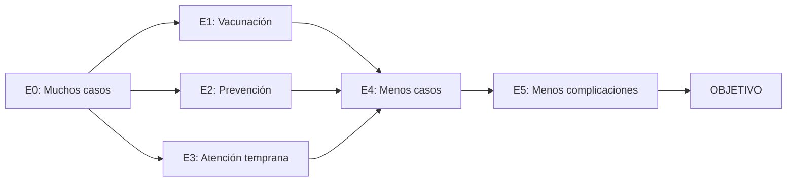

<div align="center">

# IRA INTELLIGENCE

### Pipeline de Machine Learning — Caso B: Infecciones Respiratorias Agudas

**Universidad Peruana Cayetano Heredia (UPCH)**  
**Curso:** Machine Learning  
**Docente:** Yannick Patrick Carrasco Merma  
**Autor:** **QUISPE CHARRES MATHIAS DYLAN HENRY**  
**Carrera:** Ingeniería Informática | **Año:** 2026

**[🌐 Abrir plataforma interactiva](https://dylan200-7.github.io/IRA-INTELLIGENCE/)**

</div>

---

## 1. Presentación del caso y problema — 5 puntos

Este proyecto desarrolla el **caso B: Infecciones Respiratorias Agudas (IRA)**, tomando como referencia el problema presentado en el examen parcial. El caso se enfoca en episodios de IRA y neumonía infantil en menores de cinco años en el Perú. La vigilancia epidemiológica de estos problemas se describe en fuentes institucionales como CDC Perú [1].

Según los valores incluidos en el material del caso:

| Año | Episodios de IRA |
|:---:|---:|
| 2023 | 1 003 178 |
| 2024 | 883 959 |
| 2025 | 824 978 |

El caso también menciona **113 muertes por neumonía en 2023** y **51 en 2025**. Esos valores se presentan como contexto; **no son la variable que se predice**. Las cifras provienen del **material del examen parcial** y no se han contrastado de manera independiente con una base estadística oficial.

**Problema:** aunque los episodios han disminuido en el periodo mostrado, siguen siendo numerosos. Se necesita analizar la información y representar posibles caminos de intervención que ayuden a comprender el problema.

**¿Por qué IA y Machine Learning?** La IA permite representar situaciones como estados y buscar rutas en un grafo. Machine Learning permite ajustar un modelo a datos históricos y obtener una estimación numérica. Ninguno de estos dos ejercicios demuestra que una intervención particular haya causado la disminución observada.

[Ver presentación desarrollada](docs/presentacion-caso.md)

## 2. Espacio de estados — 5 puntos

El problema se modela con siete estados:

| Estado | Descripción |
|:---:|---|
| E0 | Muchos casos de IRA y neumonía (estado inicial) |
| E1 | Mayor vacunación |
| E2 | Prevención en hogares |
| E3 | Atención temprana |
| E4 | Menos contagios y casos |
| E5 | Menos complicaciones |
| OBJETIVO | Reducir casos y muertes por IRA y neumonía infantil |

**Representación visual:**



**Operadores:** incrementar vacunación, promover medidas de prevención en hogares y facilitar la atención temprana.  
**Restricciones:** disponibilidad de recursos, acceso a establecimientos de salud y cobertura de intervenciones.

El grafo es una **representación conceptual académica**: las transiciones no describen resultados clínicos garantizados.

[Ver explicación del espacio de estados](docs/espacio-estados.md)

## 3. Pipeline de razonamiento, búsqueda y resultados — 5 puntos

Se utiliza **búsqueda en anchura (BFS)** mediante un grafo y una cola `deque` de Python [2]. El flujo es:

**Problema → Espacio de estados → Exploración → Búsqueda BFS → Resultado**.

La ruta obtenida es:

```text
E0 → E1 → E4 → E5 → OBJETIVO
```

Existen rutas de igual longitud pasando por E2 o E3. La ruta por E1 aparece primero por el orden de exploración, **no porque se haya demostrado que la vacunación sea la mejor intervención entre las tres**.

**[Abrir Notebook 01 en Google Colab](https://colab.research.google.com/drive/1J1M6N1k2tDGfgskAupz1Rbc5pt-r3fHn)**  
[Descargar Notebook 01](notebooks/01_Razonamiento_Busqueda.ipynb)

## 4. Pipeline de predicción y visualización — 5 puntos

Se desarrolló una tarea de **regresión**, utilizando como entrada el año (`X`) y como variable objetivo los episodios de IRA (`y`). Los tres valores corresponden al material del caso y se usan para entrenar una **regresión lineal** con `scikit-learn` [3].

El entrenamiento se realiza con:

```python
modelo = LinearRegression()
modelo.fit(X, y)
```

Después se realiza la predicción:

```python
prediccion_2026 = modelo.predict([[2026]])[0]
```

**Resultado: aproximadamente 725 838 episodios para 2026.** El notebook incluye una gráfica de los datos del caso, la recta de regresión y el punto estimado para 2026.

**Limitación:** el modelo se ajusta con **solo tres observaciones anuales** y no tiene un conjunto de prueba ni validación epidemiológica. La cifra de 2026 es una *estimación académica* y no una cantidad observada o un pronóstico validado.

**[Abrir Notebook 02 en Google Colab](https://colab.research.google.com/drive/1RbeuBiPupfCMM-e1aTYJhkooohWaGBW6)**  
[Descargar Notebook 02](notebooks/02_Modelo_Predictivo.ipynb)  
[Ver datos usados (CSV)](datos/ira_dataset.csv)

## Archivos del proyecto

```text
IRA-INTELLIGENCE/
├── index.html                        # Página interactiva (GitHub Pages)
├── css/                              # Estilos
├── js/                               # Animaciones, BFS y gráficos
├── assets/                           # Recursos visuales
├── datos/ira_dataset.csv             # Datos del caso
├── notebooks/
│   ├── 01_Razonamiento_Busqueda.ipynb
│   └── 02_Modelo_Predictivo.ipynb
├── docs/
│   ├── espacio-estados.md
│   ├── presentacion-caso.md
│   ├── documentacion.md
│   └── verificacion.md
└── README.md
```

La página de GitHub Pages está hecha con HTML, CSS y JavaScript. Los algoritmos académicos en Python se revisan en los notebooks de Google Colab. **La web no ejecuta Python ni un modelo remoto**; representa la búsqueda y reproduce la recta de ajuste en JavaScript.

## Referencias (formato IEEE)

[1] Centro Nacional de Epidemiología, Prevención y Control de Enfermedades, “Vigilancia de EDA/IRA/SGB (UTVEIS).” [En línea]. Disponible: https://www.dge.gob.pe/portalnuevo/vigilancia-epidemiologica/vigilancia-de-eda-ira-sgb-utveis/ .

[2] Python Software Foundation, “collections — Container datatypes.” [En línea]. Disponible: https://docs.python.org/3/library/collections.html#collections.deque .

[3] Scikit-learn Developers, “LinearRegression.” [En línea]. Disponible: https://scikit-learn.org/stable/modules/generated/sklearn.linear_model.LinearRegression.html .

**Fuente de las cifras del proyecto:** material del examen parcial, caso B (proporcionado en clase). Las referencias externas sirven como documentación técnica y de contexto; no verifican automáticamente los valores del examen.
