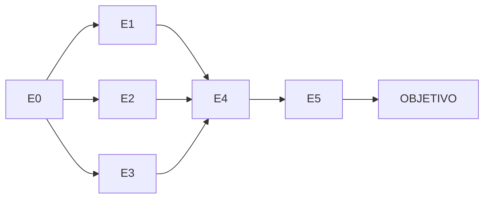

# Espacio de estados

**Autor: QUISPE CHARRES MATHIAS DYLAN HENRY**  
Universidad Peruana Cayetano Heredia — Ingeniería Informática.  
Machine Learning — Challenge Individual.  
Docente: Yannick Patrick Carrasco Merma.

| Nodo | Estado |
|---|---|
| E0 | Muchos casos de IRA y neumonía |
| E1 | Mayor vacunación |
| E2 | Prevención en hogares |
| E3 | Atención temprana |
| E4 | Menos contagios y casos |
| E5 | Menos complicaciones |
| OBJETIVO | Reducir casos y muertes por IRA y neumonía infantil |

Operadores: incrementar vacunación; promover prevención en hogares; facilitar atención temprana.

Restricciones conceptuales: disponibilidad de recursos; acceso a establecimientos de salud; cobertura de las intervenciones.

Las tres rutas E0→E1/E2/E3→E4→E5→OBJETIVO tienen cuatro aristas. BFS explora vecinos en orden E1, E2, E3 y devuelve primero la ruta por E1. No se asignan costos sanitarios, probabilidades de éxito ni garantías causales. Es una representación conceptual simplificada.
